# 《零基础大模型应用开发 70 天培训课程》10 周完整学习知识图谱与思维导图

> **定位与用法**：本文档覆盖「星辰智脑（StarMind）」70 天全周期（Week 01 ~ Week 10）的完整能力演进路线。每周均包含 **Mermaid 核心能力树图谱 + 重点代码模块索引 + 周测自查清单 + 生产高频避坑清单**，适合每周日复盘查漏补缺，也适合面试前 1 小时快速串联全局知识体系。

---

## 70 天全景成长路线图

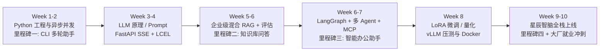

---

## 第 1 周（Day 01 - Day 07）：Python 核心语法与数据结构基石

### 1.1 核心能力树（Mermaid 知识图谱）

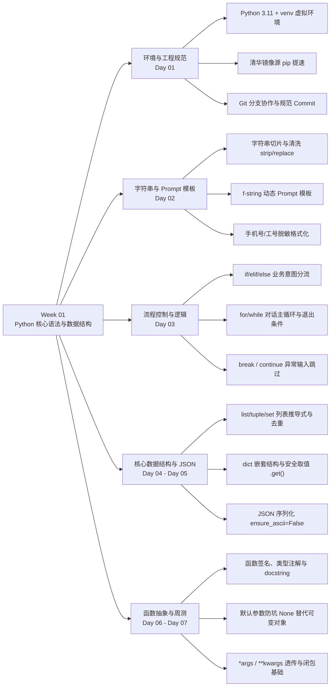

### 1.2 重点代码模块索引
- 每日演进代码：`versions/day01/` ~ `versions/day07/`
- 实操手册：`notebooks/day01/day01_practice.ipynb` ~ `notebooks/day07/day07_practice.ipynb`
- 最终平台映射：`starmind_platform/app/config.py`（类型注解与配置管理）、`starmind_platform/app/core/guardrails.py`（字符串脱敏与规则清洗）

### 1.3 周测自查点
- [ ] 能独立使用 `python3 -m venv .venv` 创建隔离环境，并通过国内清华镜像源秒装依赖。
- [ ] 能熟练读写嵌套的 OpenAI 风格 `messages` 字典列表，并用 `json.dumps(..., ensure_ascii=False, indent=2)` 美化输出中文。
- [ ] 能清晰解释为什么 `def add_msg(history=[]):` 是严重线上 Bug，并写出正确替代方案。
- [ ] 能熟练用列表/字典推导式完成工单清洗、关键词过滤与字段脱敏。

### 1.4 本周高频避坑清单
| 踩坑点 | 典型错误表现 | 正确工程做法 |
|---|---|---|
| 全局 pip 污染环境 | 装包直接全局 `pip install`，导致多项目依赖冲突 | 任何项目必须先建 `.venv` 激活后再装包 |
| JSON 中文乱码转义 | `json.dumps(data)` 输出满屏 `\u4e2d\u6587` | 统一传 `ensure_ascii=False` |
| 字典硬取 Key 崩溃 | `resp["choices"][0]` 遇到异常响应直接 `KeyError` | 链式防御取值或使用 Pydantic 模型校验 |
| 可变默认参数串话 | 多用户共享同一个默认 `history=[]` 列表 | 永远写 `history: list \| None = None` |

---

## 第 2 周（Day 08 - Day 14）：面向对象、工程化与命令行 AI 助手实战（里程碑一）

### 2.1 核心能力树（Mermaid 知识图谱）

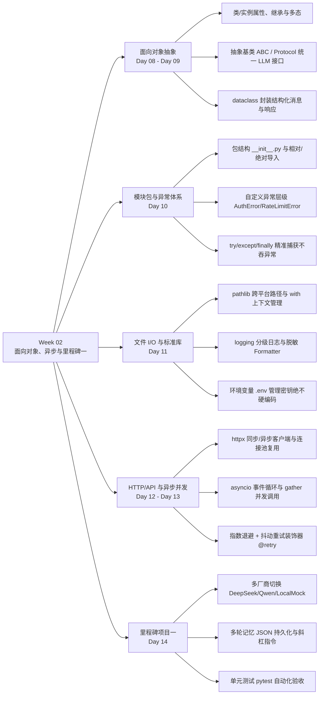

### 2.2 重点代码模块索引
- 每日演进代码：`versions/day08/` ~ `versions/day14/`
- 最终平台映射：
  - `starmind_platform/app/llm/client.py`（多厂商统一适配层与本地 Mock 降级）
  - `starmind_platform/app/core/exceptions.py`（业务异常体系）
  - `starmind_platform/app/core/retry.py`（指数退避重试装饰器）
  - `starmind_platform/app/core/logging_utils.py`（结构化脱敏日志）

### 2.3 周测自查点
- [ ] 能不看文档手写一个带 `@functools.wraps` 的“超时 + 指数退避重试”装饰器，且只对 429/5xx 重试、不重试 401/400。
- [ ] 理解为什么在 `async def` 中调用 `time.sleep` 或 `requests.get` 会卡死整个服务。
- [ ] 掌握策略模式 / `Protocol` 封装多厂商 LLM 客户端，新增一家供应商不改业务代码。
- [ ] 跑通里程碑一命令行多轮 AI 助手（含上下文持久化、`/clear` `/export` 指令与 `pytest` 单测）。

### 2.4 本周高频避坑清单
| 踩坑点 | 典型错误表现 | 正确工程做法 |
|---|---|---|
| API Key 硬编码进 Git | 把 `sk-xxxx` 写死在代码里推上仓库被盗刷 | 全部读环境变量 `os.getenv`，`.env` 写入 `.gitignore` |
| 裸写 `except Exception: pass` | 吞掉真实异常堆栈，线上静默失败无从排查 | 精准捕获可预期异常，未知异常记录完整 `exc_info=True` |
| 重试逻辑引发雪崩 | 遇到 429 立刻 `while True` 死循环狂重试 | 必须加指数退避 + 随机 Jitter + 最大重试次数上限 |
| 每次请求新建 AsyncClient | 高并发下 `TIME_WAIT` 暴增、TLS 握手拖慢延迟 | 全局单例复用连接池并在程序退出时 `aclose()` |

---

## 第 3 周（Day 15 - Day 21）：大模型原理、Prompt 工程与 Function Calling 实战

### 3.1 核心能力树（Mermaid 知识图谱）

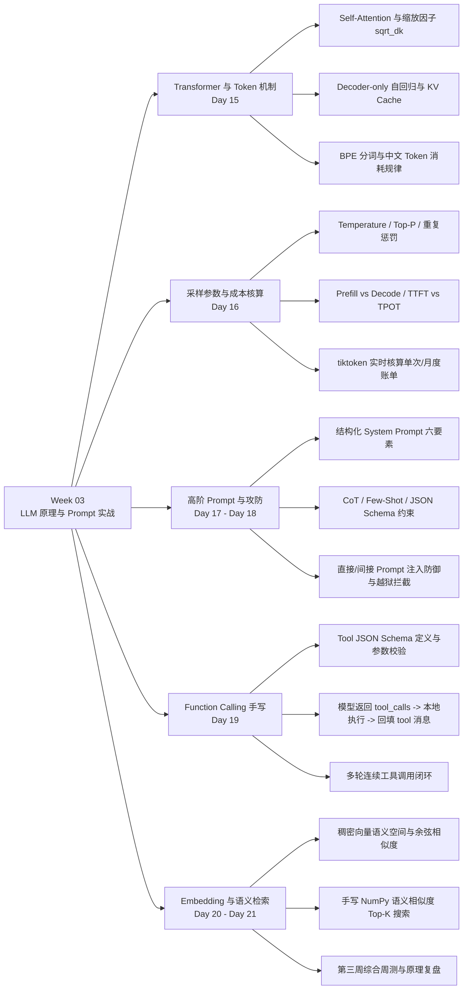

### 3.2 重点代码模块索引
- 每日演进代码：`versions/day15/` ~ `versions/day21/`
- 最终平台映射：
  - `starmind_platform/app/core/token_counter.py`（Token 精确估算与成本核算）
  - `starmind_platform/app/core/guardrails.py`（Prompt 注入规则拦截与脱敏）
  - `starmind_platform/app/agent/engine.py`（Function Calling 协议解析与工具调度）

### 3.3 周测自查点
- [ ] 能手算不同模型输入/输出 Token 费用，并解释为什么同样中文在 Qwen/DeepSeek 下比早期 Llama 省 Token。
- [ ] 能说出业务场景（RAG 事实问答 / SQL 生成 / 创意写作）对应的最佳 `temperature` 与 `top_p` 组合。
- [ ] 能脱离任何第三方框架，纯用原生 API 手写完整的 `Function Calling` 工具调用两轮闭环。
- [ ] 能列举至少 3 种防御 Prompt 注入的工程手段（XML 数据隔离、前置护栏、高危操作代码层鉴权）。

### 3.4 本周高频避坑清单
| 踩坑点 | 典型错误表现 | 正确工程做法 |
|---|---|---|
| 把动态变量放 Prompt 开头 | 每次请求都破坏 Prefix Caching，账单翻倍 | 静态指令与工具 Schema 放最前，动态时间/问题放最后 |
| 只靠 Prompt 要求“输出纯 JSON” | 线上 3% 概率带 ```` ```json ```` 或解释废话导致 `json.loads` 崩 | 开启 Structured Outputs + 后端正则剥离 + Pydantic 校验重试 |
| 信任模型传入的用户身份参数 | 把 `user_id` 暴露给 Function Calling 让模型填 | 身份/租户参数永远由后端从 JWT 强制注入，绝不交由模型生成 |
| 误以为模型自己执行了工具 | 面试被问 Function Calling 原理答成“大模型直接调接口” | 明确模型只吐结构化调用指令，真正执行在宿主 Python 应用层 |

---

## 第 4 周（Day 22 - Day 28）：FastAPI 流式 Web 开发、LangChain LCEL 与 RAG 文档预处理

### 4.1 核心能力树（Mermaid 知识图谱）

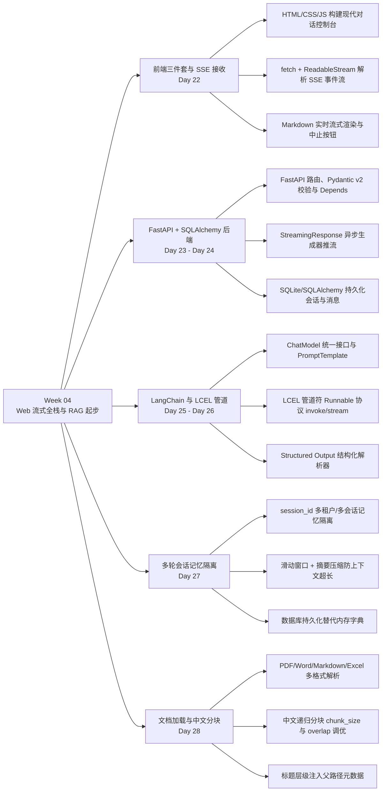

### 4.2 重点代码模块索引
- 每日演进代码：`versions/day22/` ~ `versions/day28/`
- 最终平台映射：
  - `starmind_platform/app/main.py`（FastAPI 应用入口、lifespan 与静态资源挂载）
  - `starmind_platform/app/api/routes.py`（SSE 流式对话接口与 RESTful API）
  - `starmind_platform/app/db/database.py`（SQLAlchemy 模型与会话持久化）
  - `starmind_platform/app/web/`（前端企业级控制台页面）

### 4.3 周测自查点
- [ ] 能独立搭起 FastAPI + SSE + SQLite 网页版多轮流式对话系统，刷新页面历史记录不丢失。
- [ ] 理解 FastAPI 中 `def` 与 `async def` 路由调度差异，以及 `request.is_disconnected()` 断连止损原理。
- [ ] 理解 LangChain LCEL `Runnable` 协议优势与过度封装痛点，知道何时用框架、何时写原生代码。
- [ ] 能解释中文文档分块中 `chunk_size=500, overlap=80` 的权衡，以及为什么表格不能直接按字符硬切。

### 4.4 本周高频避坑清单
| 踩坑点 | 典型错误表现 | 正确工程做法 |
|---|---|---|
| SSE 在 Nginx 下卡住一次性吐字 | 本地正常，上线过 Nginx 后等 10 秒突然蹦出全文 | 响应头加 `X-Accel-Buffering: no`，Nginx 关 `proxy_buffering` |
| 前端用 `EventSource` 发 POST | `EventSource` 仅支持 GET 且不能带自定义 Header | 改用 `fetch` + `POST` + `response.body.getReader()` 解析流 |
| 文档解析乱码直接入库 | PDF 双栏文字错行、页眉页脚污染每个 Chunk | 入库前必须做版面清洗、去页眉页脚并抽检解析产物 |
| SQLite 并发报 `database is locked` | 多请求同时写入会话表触发锁冲突 | 开启 `PRAGMA journal_mode=WAL` + 生产迁移 PostgreSQL |

---

## 第 5 周（Day 29 - Day 35）：企业级 RAG 全链路、混合检索、Rerank 与 RAGAS 评估

### 5.1 核心能力树（Mermaid 知识图谱）

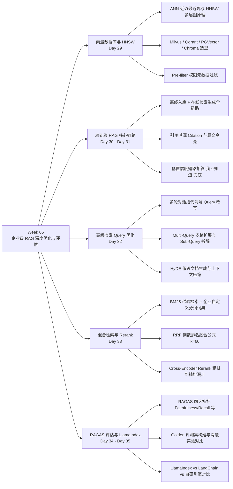

### 5.2 重点代码模块索引
- 每日演进代码：`versions/day29/` ~ `versions/day35/`
- 最终平台映射：
  - `starmind_platform/app/rag/engine.py`（中文递归分块、BM25+向量混合检索、RRF 融合、Rerank 重排、引用溯源、拒答兜底、RAGAS 评测核心实现）

### 5.3 周测自查点
- [ ] 能默写 RRF 融合公式 $\sum \frac{w_r}{k + \text{rank}_r(d)}$，并解释为什么不用原始余弦相似度与 BM25 分数直接相加。
- [ ] 能讲清 Bi-Encoder（双塔召回）与 Cross-Encoder（交叉精排）的计算复杂度与精度差异。
- [ ] 能背出 RAGAS 四大核心指标的含义，并掌握 Bad Case“入库 → 粗排 → 精排 → 生成”四步漏斗排查法。
- [ ] 能解释向量检索中 Post-filter（后过滤）导致召回结果变少的经典坑点。

### 5.4 本周高频避坑清单
| 踩坑点 | 典型错误表现 | 正确工程做法 |
|---|---|---|
| 纯向量检索上生产 | 搜错误码 `ERR_5042` 或内部项目代号完全搜不到 | 必上 **向量 + BM25（加专有词典）+ RRF** 混合检索 |
| 盲目调 Prompt 掩盖检索差 | 目标文档根本没召回，还在反复改 System Prompt | 先查 Recall@K，确保目标 Chunk 进了 Top-5 再调生成 |
| 文档更新不删旧 Chunk | 新旧两版报销制度同时被召回，模型左右互搏 | 按 `doc_id` 幂等先删旧全量 Chunk，再写入新版 |
| 检索结果全量硬塞进 Prompt | 召回 Top-20 塞 1.5 万字触发 Lost in the Middle | Rerank 精筛 Top-3~5，且把最相关放首尾 |

---

## 第 6 周（Day 36 - Day 42）：企业级知识库交付（里程碑二）、ReAct Agent 与 LangGraph 状态机

### 6.1 核心能力树（Mermaid 知识图谱）

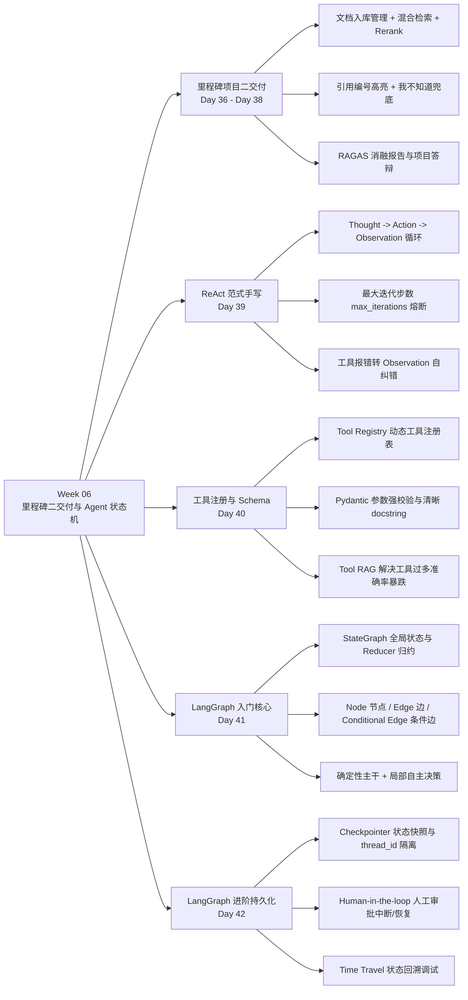

### 6.2 重点代码模块索引
- 每日演进代码：`versions/day36/` ~ `versions/day42/`
- 最终平台映射：
  - `starmind_platform/app/rag/engine.py`（里程碑二企业级 RAG 交付模块）
  - `starmind_platform/app/agent/engine.py`（ReAct、LangGraph 状态图、Checkpointer 与 HITL 审批流）

### 6.3 周测自查点
- [ ] 完成里程碑二企业级知识库问答系统交付，能清晰汇报消融实验的 Recall@5 与 Faithfulness 提升曲线。
- [ ] 能不依赖框架手写 ReAct 循环，并内置最大步数熔断与相同参数重复调用拦截。
- [ ] 能画出 LangGraph 中 `Human-in-the-loop` 人工审批中断挂起、落盘 Checkpointer、管理员点击批准后按 `thread_id` 恢复执行的完整时序图。
- [ ] 理解为什么能用确定性 Workflow 解决的任务就不要盲目上自由循环 Agent。

### 6.4 本周高频避坑清单
| 踩坑点 | 典型错误表现 | 正确工程做法 |
|---|---|---|
| ReAct 死循环烧光额度 | 工具报错后模型反复用同样错误参数重试 50 次 | 强制 `max_iterations=6` + 连续相同调用去重打断 |
| 高危写操作直接自动执行 | 模型理解偏差自动发全员公告或执行退款 | R2/R3 写操作强制走 HITL 人工审批中断 + 参数预览 |
| LangGraph 漏写 Reducer | 并行节点更新 `messages` 互相覆盖丢历史 | 使用 `Annotated[list, add_messages]` 追加归约 |
| 生产用 `MemorySaver` | 多 Worker 部署或容器重启后挂起审批状态全丢 | 中小用 `SqliteSaver`，生产集群必用 `PostgresSaver/RedisSaver` |

---

## 第 7 周（Day 43 - Day 49）：多 Agent 协作、MCP 协议、Text-to-SQL 与智能办公助手（里程碑三）

### 7.1 核心能力树（Mermaid 知识图谱）

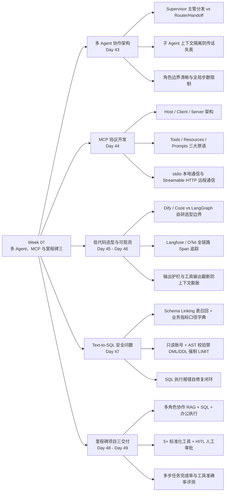

### 7.2 重点代码模块索引
- 每日演进代码：`versions/day43/` ~ `versions/day49/`
- 最终平台映射：
  - `starmind_platform/app/agent/engine.py`（Supervisor 多 Agent 路由、MCP 工具中心、Text-to-SQL 沙箱与 HITL 审批）
  - `starmind_platform/app/core/observability.py`（Span 耗时记录、TraceID 透传与调用指标统计）

### 7.3 周测自查点
- [ ] 能讲清 MCP（纵向工具集成）、Function Calling（模型底层输出）与 A2A（横向跨智能体协作）的区别与定位。
- [ ] 能说出 Text-to-SQL 防 SQL 注入和防“查爆全表”的四道工程防线。
- [ ] 能清晰判断什么时候该用 Dify/Coze 快速验证，什么时候必须用 LangGraph/自研代码上生产。
- [ ] 跑通里程碑三多 Agent 智能办公助手（覆盖知识查询、数据统计分析、高危工单人工审批恢复全流程）。

### 7.4 本周高频避坑清单
| 踩坑点 | 典型错误表现 | 正确工程做法 |
|---|---|---|
| 盲目拆 5 个 Agent 互踢皮球 | 延迟翻 4 倍、Token 暴涨、上下文传话丢关键约束 | 仅在指令冲突/上下文隔离刚需时拆多 Agent，设全局最大跳转数 |
| Text-to-SQL 直接给读写账号 | 模型幻觉或遭注入生成 `DELETE/DROP` 删库跑路 | 必配**只读库账号** + `sqlglot` AST 只放行 `SELECT` + 强制 `LIMIT` |
| 工具返回 5 万字原始 JSON | 一轮工具调用直接撑爆上下文窗口、后续推理变傻 | 工具层只返回精简 Top-N 字段与摘要，大结果落盘按需读取 |
| 无脑引入第三方未审计 MCP | 遭遇 Tool Poisoning 恶意描述诱导外泄内网密钥 | 企业内建 MCP 白名单审核机制 + 强制用户级 OAuth 鉴权 |

---

## 第 8 周（Day 50 - Day 56）：模型微调（LoRA/QLoRA）、量化、vLLM 高并发部署与 Docker 工程化

### 8.1 核心能力树（Mermaid 知识图谱）

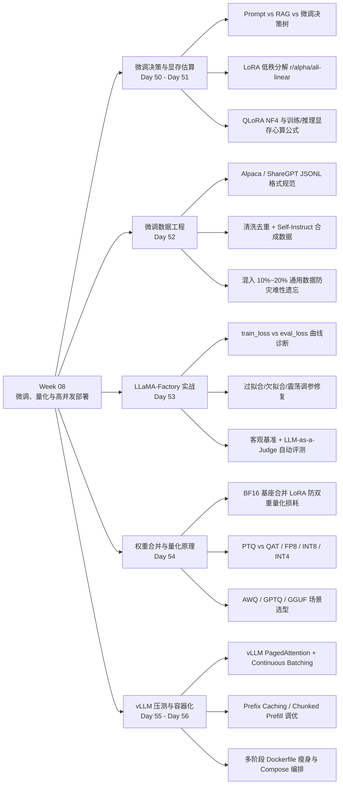

### 8.2 重点代码模块索引
- 每日演进代码：`versions/day50/` ~ `versions/day56/`
- 最终平台映射：
  - `starmind_platform/app/finetune/pipeline.py`（显存精确估算器、数据清洗合成流水线、LLaMA-Factory 配置生成与评测）
  - `Dockerfile`（多阶段构建镜像瘦身配置）
  - `docker-compose.yml`（全栈服务一键编排）

### 8.3 周测自查点
- [ ] 能不查表手算出 7B/14B/70B 模型在 FP16 推理、INT4 推理、全量微调、LoRA、QLoRA 下的显存需求。
- [ ] 能根据 `train_loss` 狂降但 `eval_loss` 上升的曲线准确判断过拟合，并给出 3 种修复手段。
- [ ] 能讲清 PagedAttention 解决 KV Cache 显存碎片的原理，以及 vLLM 与 Ollama 的生产定位差异。
- [ ] 能熟练写出多阶段构建 `Dockerfile`，并解释为什么模型权重必须外挂 Volume 而不能打进镜像。

### 8.4 本周高频避坑清单
| 踩坑点 | 典型错误表现 | 正确工程做法 |
|---|---|---|
| 为“加最新知识”去微调模型 | 花一周微调完，下周制度一改又要重新训，且依然幻觉 | 知识注入用 **RAG**，微调只管风格、格式与垂直能力蒸馏 |
| 在 4-bit QLoRA 基座上直接合并 | 合并后模型中文复读乱码、精度严重崩塌 | 先加载 FP16/BF16 原基座合并 LoRA，再做 AWQ/GPTQ 量化 |
| 生产高并发直接上 Ollama | 并发一过 10 路延迟飙升至几十秒、显存利用率极低 | 生产 GPU 集群必用 **vLLM** 或 **SGLang**，Ollama 仅限本地开发 |
| vLLM 留默认 128K `max-model-len` | 启动报错显存不足，或并发路数被压缩到个位数 | 按业务实际需求裁剪 `--max-model-len 8192/16384` 并开 Prefix Caching |

---

## 第 9 周（Day 57 - Day 63）：安全合规与星辰智脑全栈毕业设计开发（里程碑四）

### 9.1 核心能力树（Mermaid 知识图谱）

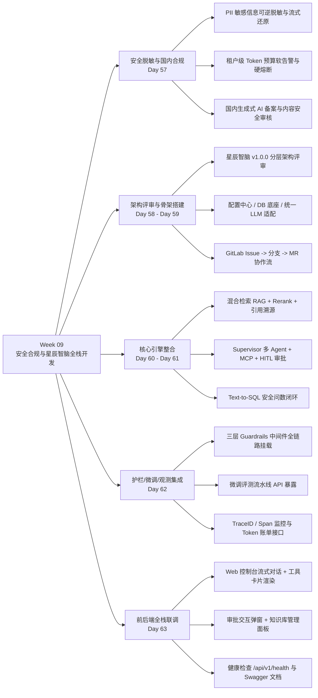

### 9.2 重点代码模块索引
- 每日演进代码：`versions/day57/` ~ `versions/day63/`
- 最终平台完整源码：`starmind_platform/`
  - `starmind_platform/app/main.py`、`starmind_platform/app/api/routes.py`
  - `starmind_platform/app/rag/engine.py`、`starmind_platform/app/agent/engine.py`
  - `starmind_platform/app/core/guardrails.py`、`starmind_platform/app/core/observability.py`
  - `starmind_platform/app/finetune/pipeline.py`、`starmind_platform/app/web/`

### 9.3 周测自查点
- [ ] 能一键启动 `uvicorn starmind_platform.app.main:app --port 8000` 并完成 Web 控制台全套功能端到端演示（流式问答、知识库上传检索、多 Agent 工具调用、人工审批恢复、脱敏拦截）。
- [ ] 讲得清流式 SSE 场景下 PII 占位符跨 chunk 切割的滑动窗口还原原理。
- [ ] 确认 `pytest starmind_platform/tests -v` 全部通过，且零外网 API Key 下 `local_mock` 引擎可 100% 离线跑通。

### 9.4 本周高频避坑清单
| 踩坑点 | 典型错误表现 | 正确工程做法 |
|---|---|---|
| 前后端联调 CORS 跨域报错 | 浏览器控制台拦截接口请求 | FastAPI 合理配置 `CORSMiddleware`（生产限定白名单域名） |
| 护栏只拦输入不拦输出 | 间接注入藏在知识库文档里，导致输出泄露敏感信息 | 输入、执行、输出三层护栏同时生效 |
| 缺少统一错误处理规范 | 内部 500 直接把 Python 堆栈暴露给前端用户 | 全局异常处理器记录详细日志，对外返回统一错误码与 `trace_id` |
| 合并集成阶段才写测试 | 改了 RAG 接口导致 Agent 模块静默崩溃 | 坚持每日单测 + `scripts/verify_all.py` 全链路回归 |

---

## 第 10 周（Day 64 - Day 70）：压测上线答辩、STAR 简历、200 题冲刺与大厂系统设计

### 10.1 核心能力树（Mermaid 知识图谱）

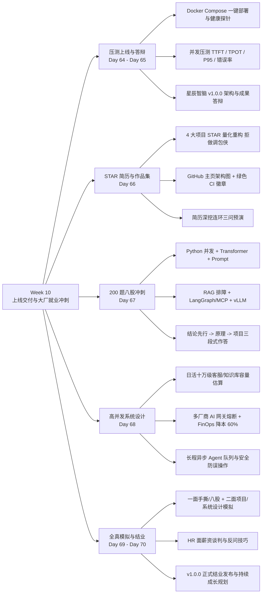

### 10.2 重点代码与求职文档索引
- 每日演进代码：`versions/day64/` ~ `versions/day70/`
- 全链路自动化验收：`scripts/verify_all.py`、`Makefile`
- 面试核心题库：`docs/career/interview_200_questions.md`（Q001 ~ Q200 完整精炼答案）
- 简历实战手册：`docs/career/resume_star_guide.md`（STAR 对比示范 + Markdown 简历模板）

### 10.3 周测与求职就绪自查点
- [ ] 完成 `docker compose up -d --build` 容器化启动与 `python scripts/verify_all.py --all` 验收。
- [ ] 准备好 1 份 1~2 页 PDF 简历，所有项目数据均有消融/压测依据，能经得起二面连环追问。
- [ ] 完整过完 `interview_200_questions.md` 的 200 道高频题，标注薄弱项做二轮强化。
- [ ] 能对着白板流畅画出「日活 10 万级企业 RAG/Agent 平台」分层架构图，并给出清晰容量估算与降本策略。

### 10.4 就业冲刺高频避坑清单
| 踩坑点 | 典型错误表现 | 正确求职做法 |
|---|---|---|
| 面试只背概念不结合项目 | 被问 RAG 调优只会背“加 Rerank”，说不出自己踩过什么坑 | 每道高频题都挂钩「星辰智脑」具体模块和实测数据 |
| 不会做容量估算直接蒙圈 | 系统设计题一上来就画组件，不问 QPS、DAU 和延迟 SLA | 动笔前先反问明确 DAU/峰值 QPS/并发长连接/安全等级 |
| 盲目海投不复盘 | 连面 5 家全挂在同样问题上，从不记录复盘 | 每次面试后 30 分钟内录音/笔记复盘，补齐盲区再投下一批 |
| 忽视代码基本功 | 只背大模型八股，一面让手写异步重试或字典统计翻车 | 保持每天 15 分钟 Python 工程手写与基础算法手感 |
